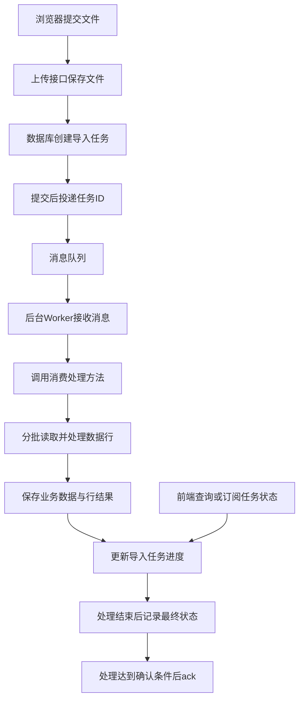

# 消息队列、Worker与异步任务进度机制

本文面向熟悉接口调用、尚不熟悉后台队列的开发者，以文件批量导入为例，说明消息队列、消费者、Worker、消费处理方法、任务回调、进度统计与失败重试之间的关系。

Worker是通用的后台执行角色，不是PHP专属概念。后台知道任务进度，是因为处理代码主动记录了业务结果；队列不会自动知道Excel成功落库了多少行。

文中的表结构、状态、接口、计数口径和伪代码属于通用设计示例，不代表某个项目已经实施，也不要求采用特定MQ、数据库或语言。Laravel仅用于解释具体框架中的名称和入口。

## 1. 先分清各个角色

| 名称 | 含义 | 文件导入中的例子 |
| --- | --- | --- |
| Producer（生产者） | 创建并投递消息的程序 | 上传接口创建导入任务并投递任务ID |
| Broker（消息中间件） | 按配置接收、存储、路由和投递消息 | RabbitMQ等消息中间件 |
| Queue（队列） | 消息等待被处理的逻辑容器 | 等待处理的文件导入任务队列 |
| Message（消息） | 队列传递的数据载体 | 包含业务任务ID的JSON |
| Job（任务） | 要执行的工作 | 解析一份Excel或处理其中一批数据 |
| Consumer（消费者） | 接收消息的程序组件 | 注册消息接收与处理逻辑的消费者 |
| Worker | 后台执行任务的单元，通常以进程或服务运行 | 持续取任务并执行导入的后台进程 |
| 消费处理方法 | 收到消息后执行的业务函数 | 读取文件、校验、去重、落库、更新进度 |

消息队列还可以用于事件分发等场景，本文只讨论工作队列。不同框架对Consumer和Worker的命名可能混用；需要看实际职责，而不是只看名称。

“消费队列的方法是不是Worker”的准确回答是：消费方法是Worker执行的处理逻辑，Worker通常指承载这段逻辑的后台进程或服务。PHP、Java、Node.js和Python都可以实现这种角色。

工作队列将耗时任务交给后台执行，避免让一次HTTP请求持续等待全部工作完成。[RabbitMQ工作队列教程](https://www.rabbitmq.com/tutorials/tutorial-two-python)

## 2. 一次异步导入的完整链路



这张图描述职责和数据流；实际ack应当发生在消息对应的工作完成并持久化之后，不能在刚收到消息时就确认。

### 上传接口做什么

1. 校验请求权限、文件格式和必要上下文。
2. 将文件保存到Worker可读取且在任务结束前有效的存储位置。
3. 创建一条独立的导入任务记录，初始状态为排队中。
4. 提交任务记录后，将业务任务ID投递到队列。
5. 返回任务ID，供前端跟踪这次导入。

队列消息可以只传任务ID：

```json
{
  "task_id": "import-123"
}
```

Worker再通过这个ID查文件路径及业务参数。通常无需把整个文件内容放入消息。

每次上传应具有可区分的执行标识。业务对象ID、上传文件记录ID、导入任务ID和队列内部消息ID可能不同，不能默认互相替代。

### 为什么Worker要单独运行

Web进程处理上传请求，Worker处理后台任务，二者生命周期独立。浏览器关闭或接口响应结束，不会天然终止已经派发的任务。

只部署Web服务而没有运行Worker，可能出现“文件上传成功、任务一直排队”的情况。Worker需要持续运行，并由适合部署环境的进程管理机制负责启动、退出重启和日志收集。

### 数据库提交与投递的顺序

如果消息在数据库事务提交之前就被消费，Worker可能查不到任务记录。支持事务后派发的框架可以解决这个先后顺序问题。[Laravel事务与队列文档](https://laravel.com/framework/docs/queues#jobs-and-database-transactions)

但“提交数据库后再投递”仍有一个失败窗口：任务记录已经提交，消息投递却失败。需要根据可靠性要求提供投递重试或补偿检查；要求更高时，可以考虑事务发件箱等方案。事务后派发不等于数据库与MQ已经成为一个原子事务。

## 3. 进度从哪里来

建议单独保存业务任务进度，而不是依赖MQ队列长度推算单个文件的完成情况。队列中消息的数量、当前执行的消息数量和Excel数据行数不是同一计量单位。

以下是示例字段，名称可以根据项目约定调整：

| 字段 | 示例含义 |
| --- | --- |
| `task_id` | 本次导入任务的唯一标识 |
| `file_path` | Worker读取的文件位置 |
| `status` | 任务当前状态 |
| `total` | 有效数据总行数，解析前可以为空 |
| `processed` | 已得到最终处理结果的行数 |
| `counts` | 成功落库的行数 |
| `skipped` | 根据明确业务规则跳过的行数 |
| `failed` | 已确定处理失败的行数 |
| `error_message` | 任务整体失败原因 |
| `updated_at` | 最近一次状态更新时间 |

统计前应定义有效数据行口径，例如是否排除表头和空行。成功数量也要明确是否包含更新已有数据；重复数据跳过时不应默认算作成功落库。

按这套示例口径：

```text
processed = counts + skipped + failed
```

全部数据行处理结束时，还应满足：

```text
processed = total
```

文件无法解析、Worker最终失败等情况，任务可能提前终止。此时保留真实的部分计数，将状态标记为失败，不能为了达到100%而填满计数。有效数据为0行时也应明确结束结果，前端避免计算除以0的进度。

示例：

```json
{
  "task_id": "import-123",
  "status": "processing",
  "total": 1000,
  "processed": 320,
  "counts": 300,
  "skipped": 15,
  "failed": 5
}
```

总行数还未确定时，可以展示“已处理320行”，无需构造百分比。

## 4. 回调、消费方法与前端通知的区别

| 位置 | 触发时机 | 适合承担的职责 |
| --- | --- | --- |
| 消费处理方法 | Worker取得一条消息后 | 执行业务工作，维护行结果和处理中进度 |
| 每行／每批处理完成后的业务回调 | 数据行或分块得到结果后 | 汇总业务计数、记录行错误 |
| 任务成功回调 | 一个Job或一批Job达到框架定义的成功条件后 | 完成状态收尾、触发通知 |
| 任务失败回调 | 达到框架定义的失败条件后 | 记录最终失败原因并告警 |
| 前端消息回调 | 浏览器收到推送消息后 | 更新页面展示，必要时查询最新状态 |

这些回调通常是执行进程调用的函数，并不意味着MQ重新向原上传接口发送HTTP请求。把任务更新成完成后，是否发送WebSocket消息，是另外一项业务动作。

业务进度不能只依赖“整个Job完成”的回调。一个Job循环处理1000行Excel时，框架只知道一个Job的生命周期，逐行进度仍由消费处理代码记录。

Laravel的`handle()`是执行入口，`failed()`用于任务失败处理；批任务提供`progress`、`then`、`catch`、`finally`等回调。批任务回调统计的Job完成情况，不能在没有行数映射的情况下直接当成Excel行进度。具体语义和可用API应核对项目实际框架版本。[Laravel队列文档](https://laravel.com/framework/docs/queues)

## 5. 任务如何拆分

| 方式 | 优点 | 需要处理的问题 |
| --- | --- | --- |
| 一份文件一个Job，内部逐行或分块处理 | 编排简单，容易理解 | 长任务超时、失败后的恢复位置 |
| 一行一个Job | 行级重试和并行较直接 | 消息数量大，调度和计数开销增加 |
| 一批数据一个Job | 可平衡调度开销和恢复粒度 | 分块重试、块内行结果和最终汇总 |

逐行落库不等于每行必须投递一个Job。可先按实际数据量和处理耗时选择简单方案；分块大小、并发数、超时与重试间隔需要验证，不设通用固定值。

如果并行执行多个Job，不应依赖消息入队顺序推导业务完成顺序。有前后依赖的数据，需要显式编排。

下面是业务流程伪代码，不对应某个框架的可运行API：

```text
processImport(taskId):
    将任务改为 processing
    分批解析文件，确定有效总行数

    对每个待处理数据行：
        processRowOnce(taskId, rowNumber, rowData)

    汇总行结果
    全部得到最终结果后，标记 completed

processRowOnce(taskId, rowNumber, rowData):
    在数据库事务中：
        创建或锁定这一行的处理记录
        若已有最终结果，直接返回

        校验、检查业务重复并按规则保存数据
        将结果记录为成功、跳过或业务失败
        原子更新任务计数
```

这里的确定性业务错误可以转换为失败结果，继续处理其他行；数据库临时不可用等异常应使事务回滚，再按重试策略处理。不能把所有异常都转换为跳过或成功。

## 6. ack、重试与幂等

ack是消费者向MQ确认消息已处理的机制，不是给浏览器的成功响应。以RabbitMQ的手动确认模式为例，消费者在未确认消息时断开，消息可能被重新入队并交给其他消费者处理。[RabbitMQ消息确认说明](https://www.rabbitmq.com/tutorials/tutorial-two-python#message-acknowledgment)

一个典型失败窗口是：

```text
业务数据已经提交
    ↓
Worker在发送ack前退出
    ↓
消息重新投递
    ↓
同一任务再次执行
```

因此应按可能重复执行来设计，不能认为“配置重试次数为1”或“确认消息”就天然保证业务只执行一次。投递与确认行为还取决于所用中间件、框架和配置。

### 区分两类去重

- **业务数据去重**：不同导入任务中的数据是否指向同一业务对象。
- **任务执行幂等**：同一次导入的同一行被重新执行时，不重复写入或累计计数。

可使用`task_id + row_number`作为本次导入行结果的唯一约束，并配合事务和锁进行最终状态判断。唯一约束本身不能替代完整的事务处理。

用户再次上传相同文件可以创建另一个导入任务，是否插入、更新或跳过仍由业务去重规则决定。

### 业务结果与进度保持一致

在同一个数据库内，可以将业务写入、行结果记录和任务计数更新放在同一事务中。回滚时三者一起回滚，避免出现“数据没保存，但成功数量已经增加”。

如果业务数据和进度分别保存在数据库、Redis等不同系统中，普通数据库事务不能覆盖两者，需要额外设计一致性和恢复机制。

### 并行计数不能先读后写

两个Worker同时读到`processed = 100`，各自加1后保存，最终可能只得到101。可以使用数据库原子递增：

```sql
UPDATE import_tasks
SET processed = processed + 1,
    counts = counts + 1
WHERE task_id = ?;
```

这只是“成功一行”的计数示例，必须在确认该行尚未结算的事务流程中执行。原子递增解决并发覆盖，行级幂等解决重复累计，两者不能相互替代。

## 7. 错误与最终状态

| 情况 | 示例处理 |
| --- | --- |
| 确定性行错误 | 记录行号、业务原因，计入失败行，继续处理其他行 |
| 业务重复 | 根据业务规则计入跳过或更新成功，口径保持一致 |
| 可恢复异常 | 回滚未完成事务，按策略重试；重试期间暂不计入最终失败行 |
| 重试耗尽或不可恢复的任务错误 | 标记任务失败，保留已完成计数和错误摘要 |
| 全部行已有结果但部分行失败 | 标记处理结束，保留失败数量；可使用completed_with_errors等明确状态 |

不要在每次临时失败时都增加最终失败数量，否则一次数据行的多次尝试会被重复累计。

失败回调适合任务级收尾，但进程被强制终止或机器掉线时，不能假定任意业务回调都必然执行。需要框架的超时、重试和失败任务机制，并可配合心跳或更新时间检查长时间停滞的任务。

## 8. 前端如何获取进度

前端通常通过业务接口读取任务状态，而不是直接连接MQ读取队列内部指标。

示例接口职责：

```text
上传／受理接口：返回task_id以及当前任务状态
任务查询接口：返回状态、总行数、已处理、成功、跳过和失败数量
失败明细接口：按需查询错误行，避免将大量明细塞进进度响应
```

开始时可以采用轮询，例如约2秒查询一次；这只是示例间隔。任务达到终态后停止轮询，暂时网络失败不应直接将后台任务判为失败。

需要更及时的反馈时，可以增加WebSocket或SSE推送，并保留查询接口，用于刷新页面、关闭后重开、断线重连和漏消息后的恢复。推送可以按时间或处理批次节流，不必每行发送一条消息。查询和推送都应校验任务归属与访问权限。

| 业务状态 | 前端示例展示 |
| --- | --- |
| 排队中 | 文件已接收，等待处理 |
| 处理中且总数未知 | 正在处理，已处理320行 |
| 处理中且总数已知 | 已处理320／1000行，成功300行 |
| 处理完成 | 成功导入950行，重复跳过30行，失败20行 |
| 任务失败 | 显示任务失败原因及真实的已处理数量 |

文件传输进度、任务受理结果、后台处理进度和最终成功数量是不同的状态。接口采用HTTP成功或业务码200表示受理时，不能仅据此展示最终导入成功条数。

## 9. PHP与Laravel示例

PHP可以通过持续运行的命令行进程承担Worker角色。若采用Laravel队列，启动Worker的基础命令示例是：

```bash
php artisan queue:work
```

命令执行的是队列Worker，具体业务逻辑仍由Job处理方法承担。这个示例不代表当前业务项目使用Laravel，也不包含实际连接、队列、超时或重试配置。正式使用时应核对框架版本，并由部署环境托管Worker生命周期。[Laravel运行Worker文档](https://laravel.com/framework/docs/queues#running-the-queue-worker)

## 10. 实施前需要明确的契约

1. 队列中间件、框架、版本及实际投递、确认、重试语义。
2. 一次上传和业务任务的对应关系，任务ID是否每次执行独立。
3. 有效行数、成功、更新、重复跳过和失败的统计口径。
4. 文件存储如何供Worker访问，什么时候可以清理。
5. 数据库、行结果与进度是否能纳入同一事务，以及投递失败如何恢复。
6. 拆分方式、超时、并发、重试上限和停滞检测。
7. 任务查询、推送、失败明细及权限校验接口。
8. 关闭页面、重复上传、断线和重开后的状态恢复。

这些是落地时需要结合项目选择的事项，不是本文已经替项目做出的架构决策。

## 来源与归档范围

- [RabbitMQ Work Queues](https://www.rabbitmq.com/tutorials/tutorial-two-python)：工作队列、后台消费者和消息确认机制。
- [Laravel Queues](https://laravel.com/framework/docs/queues)：Job、事务后派发、批任务回调、Worker及失败处理示例。
- 2026-10-22技术讨论：概念解释和通用导入进度方案整理。

正文为通用技术说明；来源文档按本次查阅版本使用，具体项目实施时应再次核对对应版本。本文未纳入具体项目的接口地址、临时counts字段、is_submit字段解释、用户或文件路径，不把示例方案记录为已经部署的能力。
