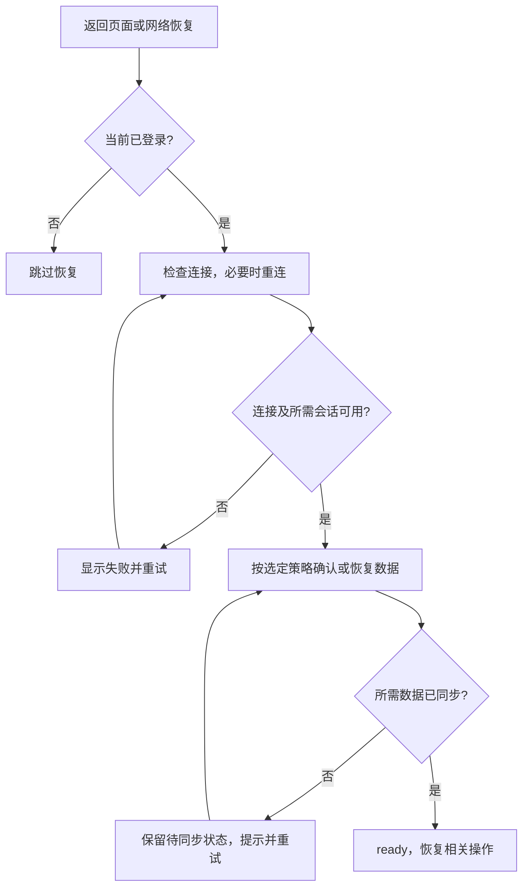

# IPD 页面返回时 WebSocket 连接检查与恢复方案

本文整理 IPD 应用级页面返回恢复的现状与建议，当前为未实施草案。需求已由用户确认，技术判断来自源码静态检查，尚未进行浏览器复现或服务端联调。

## 1. 需求与恢复边界

用户希望任何时刻回到页面，都能正常使用 WS 及其关联数据，包含两个条件：

- **连接可用**：客户端能与服务端通信，并恢复所需登录和协作会话。
- **数据完整**：本地已获得当前业务所需数据，连接或消息处理异常造成的缺口已恢复。

部分数据通过 WS 获取，中途异常可能造成本地数据不全。用户确认，此前刷新页面也用于重新执行初始化、从服务端拉取数据。因此，心跳或重连成功后不能直接认定页面已经恢复，现阶段仍需保留重新加载数据的路径。

网络或服务端不可用时，无法保证返回瞬间连通。建议在返回时立即启动检查，恢复期间限制依赖未同步数据的操作，完成连接恢复和数据同步后再放行；具体限制范围待确认。

## 2. 当前实现

### 2.1 页面隐藏与返回

`src/App.vue:69` 注册原生 `visibilitychange` 监听：进入 `hidden` 时记录 `Date.now()`，重新可见时计算本次隐藏时长。超过 30 分钟，弹出“页面与服务器已断开连接，页面将自动刷新”；点击确定后，先将 `noNet`、`wsDisConnected` 设为 `false`，再调用 `window.location.reload()`。

这里没有定时刷新，持续隐藏满 30 分钟时不会主动处理；多次隐藏不累计，恰好 30 分钟不触发。返回时也没有探测连接或调用重连。页面隐藏可能来自切换标签页、最小化等行为，不能据此判断设备是否休眠。

### 2.2 网络事件、提示与遮罩

| 入口 | 当前行为 |
| --- | --- |
| `wsDisConnected` 变为 `true` | 关闭当前保存的提示弹窗；符合路由条件时显示断网遮罩 |
| `wsDisConnected` 变为 `false` | 弹出“网络已重新连接，页面将自动刷新”，确定后刷新 |
| 浏览器 `offline` | 设置 `noNet = true`，关闭当前保存的提示弹窗 |
| 浏览器 `online` | 设置 `noNet = false`，调用 `reconnect()` 后立即弹出恢复提示，不等待结果 |

`wsDisConnected` 的监听没有开启 `immediate`，初始值为 `false` 本身不会触发提示。断网遮罩要求有 token，且路由为 `PFD_CANVAS`、`ELEMENT_FORM` 或 `DATA_MGR_EDITOR`；全局刷新提示没有相同限制，ICCE 详情页也不在遮罩名单中。

### 2.3 连接与消息处理

`src/store/useWsStore.ts` 使用 `useWebSocket()`：

- 心跳间隔、响应超时均为 25 秒，自动重连配置为 `retries: 10`、`delay: 5000`；另有每 5 秒检查断开计数、达到阈值后调用 `reconnect()` 的轮询。
- `onConnected` 将 `wsDisConnected` 设为 `false`，再发送 `Login` 和已保存的 `Join`，没有等待认证或加入会话确认。
- `onDisconnected` 增加计数并设置断开状态，没有实现注释所述的手动关闭过滤；清空 token 也会将断开状态重置为 `false`。
- `reconnect()` 关闭旧实例、创建新实例，并重新赋值局部 `send`、`status`、`close`。
- `onMessage` 将 JSON 解析和订阅回调放在同一个同步 `try/catch` 中；失败只打印“WebSocket 消息解析错误”，没有维护数据是否完整的状态。

## 3. 当前问题

| 问题 | 影响 |
| --- | --- |
| 隐藏时长代替连接与数据检查 | 长时间离开就提示断线，短时间离开后的异常又不能由返回监听主动恢复；30 分钟阈值不能证明数据完整 |
| 恢复成功判断过早 | `online` 不代表业务服务可达，`onConnected` 也不代表认证、会话及数据恢复完成 |
| 数据异常历史丢失 | 连接恢复就清除 `wsDisConnected`，无法表达后台已重连但数据仍待补齐的情况 |
| UI 直接修改连接状态 | `hideModal()` 将连接标志设为正常，却未建立或验证连接；token 清理也可能被监听器误判为恢复 |
| 多入口重复弹窗 | 超时、联网和 WS 恢复各自创建弹窗，`noNetModal` 只保留最后一个句柄，旧弹窗可能无法统一关闭 |
| 遮罩范围和层级不一致 | 全局提示缺少登录、路由限制；断网遮罩的 `z-index: 2147483647` 高于快捷弹窗容器的 `5000`，可能遮住提示 |
| 对外状态引用可能过期 | 重新赋值局部 `status` 不会替换 store 已返回的 ref，外部可能继续读取旧连接状态 |
| 监听与时间起点缺少保护 | 匿名原生监听未移除；注册时已隐藏且未观察到 hidden 事件时，首次可见可能按 `Date.now() - 0` 误判超时 |
| 消息失败缺少分类与上报 | 解析失败、同步业务回调抛错共用日志；一个回调抛错会中止后续回调，Promise 回调的异步失败不能由该同步 catch 捕获 |
| 刷新交互未覆盖恢复边界 | 实际依赖确定按钮，当前 Arco 默认允许 Esc 关闭；刷新回调未检查未持久化编辑，具体丢失风险待核实 |

周期心跳也不能代替返回时检查：浏览器可能冻结后台页面并暂停定时器。即使没有连接错误，服务端未推送、订阅未注册、错误过滤或处理遗漏等静默问题，也可能造成数据缺口。

## 4. 建议的恢复方案

### 4.1 恢复流程与完成条件

建议由 App 协调页面恢复，store 负责连接检查与重连，业务页面负责数据重建。整个流程只保留一个正在执行的任务，多个事件共享结果，避免并发重连、重载和重复提示。

页面状态可使用 `checking`、`reconnecting`、`syncing`、`ready`、`failed`，或分别维护连接与数据状态。恢复较快时自动完成，较慢时区分“正在恢复连接”和“正在同步数据”，失败时提供重试入口。执行了 `reload()` 只代表恢复已启动，重新进入页面后仍需确认初始化成功。

### 4.2 触发与连接检查

建议在页面变为 `visible`、窗口重新获得 `focus`、`pageshow` 从缓存恢复、可见页面收到 `online`，以及登录和首次初始化时，调用统一连接入口 `ensureConnected()`。首次连接执行初始化，不能因首次建连反复刷新。正常使用期间保留周期心跳，返回时立即额外探测，不以离开时长决定是否检查。

| 当前情况 | 连接层动作 |
| --- | --- |
| 无 token | 跳过；登出时终止等待、检查和重试 |
| 连接为 `OPEN` | 立即发送应用层心跳，等待本次探测的有效响应 |
| 正在连接 | 等待当前连接结果并设置超时，不重复建连 |
| 已关闭、正在关闭，或探测超时 | 安全结束旧连接并进入统一重连流程 |
| 连接恢复 | 按协议恢复登录和会话，将结果交给数据恢复流程 |

`OPEN` 和 `send()` 返回值均不足以证明服务端已处理消息。探测应复用并核实现有心跳协议，若支持请求编号则匹配本次响应；探测消息不应缓冲到未来的新连接发送。旧连接和旧探测的迟到回调不能覆盖当前状态。服务端若有 `Login`、`Join` 的确认或失败响应，应纳入恢复判断；协议未核实前需明确当前能确认到哪一层。

### 4.3 数据待恢复的判断依据

建议增加归属于当前业务会话的 `needsResync`，记录异常后尚未恢复的数据状态。它与当前连接状态独立，只能在所需数据完整重载或确认补齐后清除。退出或切换会话时按生命周期处理，旧回调不能影响新会话。

| 信号 | 能判断什么 | 建议处理 |
| --- | --- | --- |
| 已建立连接触发 `onDisconnected` | 连接确实关闭过 | 非预期关闭时设置 `needsResync` |
| 主动心跳探测超时 | 当前连接无法确认可用 | 设置 `needsResync` 并重连 |
| `onError` | 连接出现错误 | 进入检查与恢复流程，不能据此判断业务处理结果 |
| 浏览器 `offline` | 浏览器判断网络断开 | 标记可能失去同步，返回时验证并恢复 |
| 浏览器 `online` | 网络状态发生变化 | 发起检查，不能清除待同步状态 |
| 页面初始化后再次触发 `onConnected` | 连接已重新建立，包含 VueUse 自动重连 | 保留或设置 `needsResync`，不能直接放行业务 |

主动退出、页面销毁等预期关闭应明确记录原因。不能只按 close code 或 `wasClean` 排除数据缺口，正常完成关闭握手也可能需要重新同步。应用侧应上报心跳超时等原因，便于区分异常来源。

例如，后台断线时设置 `needsResync = true`，后台自动重连后继续保留，返回页面重新加载数据，恢复完成后才清除。心跳成功和 `onConnected` 均不能替代最后一步。

消息处理是否失败，应由业务处理器在同步、异步边界分别上报，并隔离订阅回调，避免一个失败阻断其他订阅：

| 消息处理结果 | 是否重新同步正式数据 |
| --- | --- |
| 正式数据消息无法解析或结构不符合约定 | 是；无法识别归属时需保守评估影响范围 |
| Store 更新失败，或一批正式更新只应用了部分 | 是 |
| 当前业务本应处理的消息因数据未就绪而丢弃 | 是 |
| 其他业务或画布的消息被正常过滤 | 否，属于正常分流 |
| 鼠标、临时预览等允许丢帧的过程消息失败 | 通常不重载正式数据，按过程态规则处理 |

未知消息、过滤返回和异常不能一律触发刷新，需要判断是否影响正式数据。持续的代码或协议错误应展示失败并限制重复恢复，避免刷新后再次出错形成循环。

### 4.4 数据完整性与重新加载策略

上述监测只能发现已知异常，没有异常证据仍不能证明数据完整。本轮检查的 WS store 与 ICCE 协作接入链路中，未见统一的消息连续序号或数据版本校验。已有注释提到 Join 后缓存补发，但其范围、去重及完整性保证尚未核实，也不能据此推断全部后台协议的能力。

| 策略 | 能力与前提 | 当前定位 |
| --- | --- | --- |
| 已知异常后重载 | 根据 `needsResync` 恢复，能处理已识别的断线与处理失败，不能覆盖所有静默缺口 | 风险控制手段，不能宣称完整保证 |
| 每次返回都重载相关数据 | 不依赖异常是否被发现；需明确完整数据范围、初始化成功条件与实时消息衔接 | 当前较易落地的完整恢复路径，具体交互待定 |
| 返回时校验版本或消息连续性，必要时补齐 | 确认一致或可靠补齐后可跳过重载；依赖服务端协议及本地处理完整性判断 | 后续优化方向，后台能力待核实 |

若要求每次返回都确认数据完整，需要在后两种策略中明确恢复依据，当前尚未选定最终方案。隐藏时长只能控制检查或刷新频率。

短期保留整页刷新或重新初始化作为恢复手段，先统一触发、去重与状态展示。只有确认页面级重载能完整覆盖数据恢复后，才评估替代整页刷新；加载快照时还需正确衔接实时更新，防止新更新被旧快照覆盖或加载期间再次遗漏。刷新确认、未保存编辑的处理和重复恢复限制应一并确定。

## 5. 实施落点与待确认事项

| 位置 | 待实施内容 |
| --- | --- |
| `src/App.vue` | 统一返回及网络事件、自动清理监听、协调恢复任务与反馈，去重提示并保留数据重载路径 |
| `src/store/useWsStore.ts` | 实现连接探测和超时，收拢自动重连、轮询与手动重连调度；保持对外状态引用稳定，处理旧回调与登出清理 |
| 业务页面与消息处理器 | 梳理初始化和 WS 数据依赖，上报正式数据应用失败，维护同步状态并确认恢复完成 |

可评估复用单个 `useWebSocket` 实例及其 `open()`，避免反复创建实例导致状态和资源分散。协作过程态、提交态和回放边界继续遵循 [[ICCE画布交互协作设计方案]]，不恢复旧 pointer session。

实施前仍需确认：

- **协议**：心跳请求与响应格式、探测关联方式、认证和加入会话确认，以及版本校验、缓存补发的实际保证。
- **数据**：受 WS 影响的完整数据范围、初始化完成条件、快照与实时更新的衔接、重新同步状态的会话归属及清除依据。
- **策略与交互**：是否每次返回重载、何时允许跳过重载、刷新确认方式、未保存编辑处理、限制操作的范围和提示延迟。
- **参数**：探测与建连超时、重试间隔。此前讨论的 5 秒探测超时、10 秒建连超时仅为起始建议。

本方案未决定替换 WS 技术栈，也未预设新增可靠投递、离线操作队列或协作协议框架。当前仅完成分析和文档整理，业务代码、后台协议与恢复能力均未因本次归档而改变。

## 附录：依据与修订记录

源码基线见文首 `source_ref`。归档时 `src/App.vue`、`src/store/useWsStore.ts` 无工作区差异；连接和界面结论还参考了当前安装的 VueUse、Arco 实现。刷新目的与本地数据缺口风险由用户确认，具体数据范围和端到端恢复效果仍待核实。

2026-10-30 最初按连接健康需求讨论了即时心跳、自动重连和取消默认整页刷新；用户补充刷新承担重新拉取数据的目的后，建议修订为共同确认连接与数据完整性，保留刷新或初始化保障。随后补充异常判据及监测盲区。本次将逐次补充整合为完整方案，保留这些修订及根目录日志，技术方案仍为草案。

## 参考资料

- [MDN：visibilitychange](https://developer.mozilla.org/en-US/docs/Web/API/Document/visibilitychange_event)：页面可见性事件的语义。
- [MDN：Navigator.onLine](https://developer.mozilla.org/en-US/docs/Web/API/Navigator/onLine)：浏览器联网状态不能证明业务服务可达。
- [MDN：WebSocket 客户端](https://developer.mozilla.org/en-US/docs/Web/API/WebSockets_API/Writing_WebSocket_client_applications)：应用层心跳示例与异步发送行为。
- [Chrome：页面生命周期](https://developer.chrome.com/docs/web-platform/page-lifecycle-api)：后台冻结、恢复和定时器暂停。
- [MDN：WebSocket close](https://developer.mozilla.org/en-US/docs/Web/API/WebSocket/close_event)：连接关闭事件。
- [MDN：WebSocket error](https://developer.mozilla.org/en-US/docs/Web/API/WebSocket/error_event)：连接错误事件，与业务处理失败分开判断。
