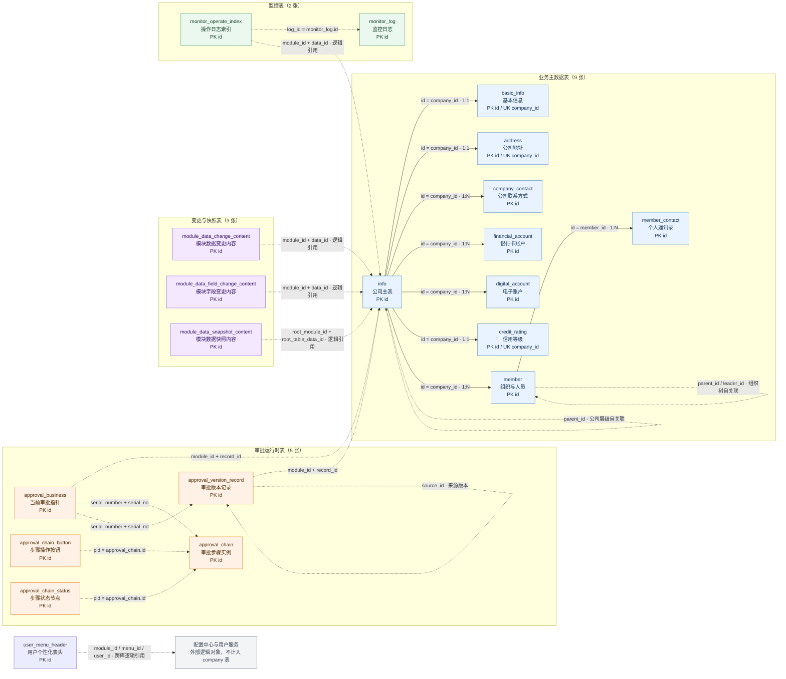

# 05 company 业务库全表关系图

> 核验范围：开发环境 `company` 业务库实际表结构、配置中心 `sys_table_relation` 和当前源码中的表访问逻辑。核验日期为 2026-09-22。`school` 示例项目不在本图范围内。

## 1. 关系图

图例：实线表示配置中心 `sys_table_relation` 已确认的业务表关系；虚线表示根据字段语义和源码访问链路整理出的逻辑关系，不代表数据库声明了外键。当前数据库没有声明物理外键。

## 2. 20 张表清单

| 分组 | 表 | 主要职责 | 关系证据 |
|---|---|---|---|
| 主数据 | `info` | 公司主记录和公司层级 | 配置中心主表；`parent_id` 自关联 |
| 主数据 | `basic_info` | 工商资质和基本信息 | `company_id` 唯一关联 `info.id` |
| 主数据 | `member` | 组织与人员节点 | `company_id` 关联 `info.id`；`parent_id`、`leader_id` 形成组织树语义 |
| 主数据 | `member_contact` | 人员联系方式 | `member_id` 关联 `member.id` |
| 主数据 | `address` | 公司地址 | `company_id` 唯一关联 `info.id` |
| 主数据 | `company_contact` | 公司对外联系方式 | `company_id` 关联 `info.id` |
| 主数据 | `financial_account` | 银行卡结算账户 | `company_id` 关联 `info.id` |
| 主数据 | `digital_account` | 电子结算账户 | `company_id` 关联 `info.id` |
| 主数据 | `credit_rating` | 公司信用等级 | `company_id` 唯一关联 `info.id` |
| 审批 | `approval_business` | 当前审批版本和状态指针 | `module_id + record_id` 逻辑关联业务记录 |
| 审批 | `approval_chain` | 单据审批步骤运行时实例 | 通过流水编号、步骤号关联 `approval_business` |
| 审批 | `approval_chain_button` | 当前步骤的通过、驳回等按钮 | `pid` 逻辑指向 `approval_chain.id` |
| 审批 | `approval_chain_status` | 当前步骤和下一步骤状态节点 | `pid` 逻辑指向 `approval_chain.id` |
| 审批 | `approval_version_record` | 审批版本历史 | 通过流水编号关联当前审批；`source_id` 指向来源版本 |
| 变更 | `module_data_change_content` | 模块数据级变更内容 | 通过模块、业务记录和动作编号逻辑关联 |
| 变更 | `module_data_field_change_content` | 模块字段级变更内容 | 通过模块、业务记录和字段编号逻辑关联 |
| 变更 | `module_data_snapshot_content` | 模块数据快照和比对内容 | 通过根模块、根业务记录逻辑关联 |
| 监控 | `monitor_log` | 操作、消息和系统监控日志 | 日志主体表；含模块和业务记录标识 |
| 监控 | `monitor_operate_index` | 按模块和业务记录反查操作日志 | `log_id` 逻辑指向 `monitor_log.id` |
| 表头 | `user_menu_header` | 用户个性化菜单表头 | 通过用户、菜单、模块和项目编号跨库逻辑关联 |

## 3. 已确认的主子表关系

配置中心 `sys_table_relation` 针对 `project_no=company` 返回 8 条关系：

| 主表 | 主字段 | 子表 | 子字段 | 类型 | 说明 |
|---|---|---|---|---|---|
| `info` | `id` | `basic_info` | `company_id` | 1:1 | 工商资质详情 |
| `info` | `id` | `member` | `company_id` | 1:N | 组织与人员架构 |
| `member` | `id` | `member_contact` | `member_id` | 1:N | 个人联系方式 |
| `info` | `id` | `address` | `company_id` | 1:1 | 公司地址 |
| `info` | `id` | `company_contact` | `company_id` | 1:N | 公司联系方式 |
| `info` | `id` | `financial_account` | `company_id` | 1:N | 银行卡账户 |
| `info` | `id` | `digital_account` | `company_id` | 1:N | 电子账户 |
| `info` | `id` | `credit_rating` | `company_id` | 1:1 | 信用等级 |

这些关系由配置中心驱动动态查询和树形装配。实际数据库中没有对应的 `FOREIGN KEY` 约束，关系正确性依赖配置、字段命名、索引和应用层逻辑共同维护。

## 4. 其他逻辑关系说明

### 审批运行时表

审批表不直接保存业务正文。`approval_business` 和 `approval_version_record` 通过 `module_id + record_id` 指向实际业务记录；审批步骤、按钮和状态通过流水编号、流水序号、当前步骤和 `pid` 关联。对于当前 company 样本，模块 `1001` 的业务记录对应 `info` 表记录。

### 变更与快照表

三张变更表通过模块编号、根记录编号、数据编号、动作编号或字段编号表达变更上下文。当前源码和数据库均未发现它们之间或与业务主表之间的物理外键，因此图中使用逻辑虚线；不能把这些字段直接解释为数据库级父子关系。

### 监控表

`monitor_operate_index` 用 `log_id` 建立操作日志索引，业务代码先按模块编号和数据编号查询索引，再回查 `monitor_log` 明细。该关系由代码维护，数据库没有声明外键。

### 用户个性化表头

`user_menu_header` 位于 company 业务库，但其 `user_id`、`menu_id`、`module_id` 和 `project_no` 指向用户服务及配置中心的逻辑对象，不属于 company 内部表关系。图中以外部逻辑对象表示，避免误认为 company 内存在对应的用户、菜单或模块表。

## 5. 核验边界

- 本图覆盖开发环境 `company` 数据库实际发现的 20 张表，不包含 `school` 示例库。
- 关系图同时展示配置中心已确认关系和源码/字段推导关系，线型已经区分确定性。
- 未发现 company 数据库物理外键；不存在配置关系或可靠源码关联的表，不强行补画表间关系。
- 表中字段只记录结构性键名，没有记录业务正文、连接凭据或具体敏感数据。
- 后续如果新增表、修改 `sys_table_relation` 或调整审批运行时结构，应重新核验并更新本图。
